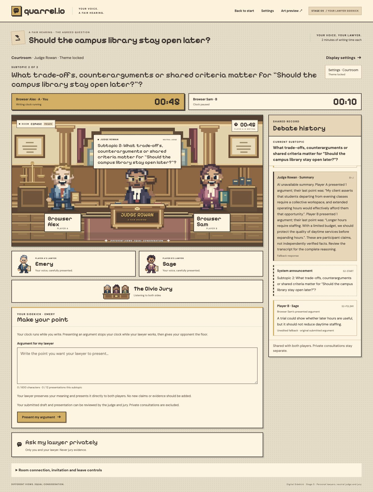
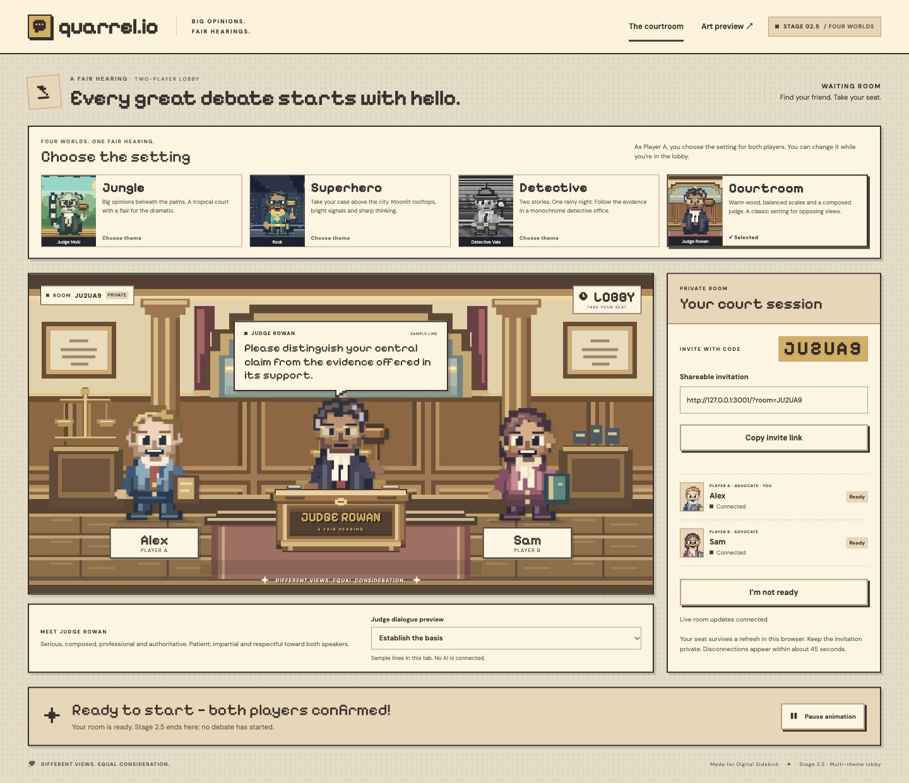
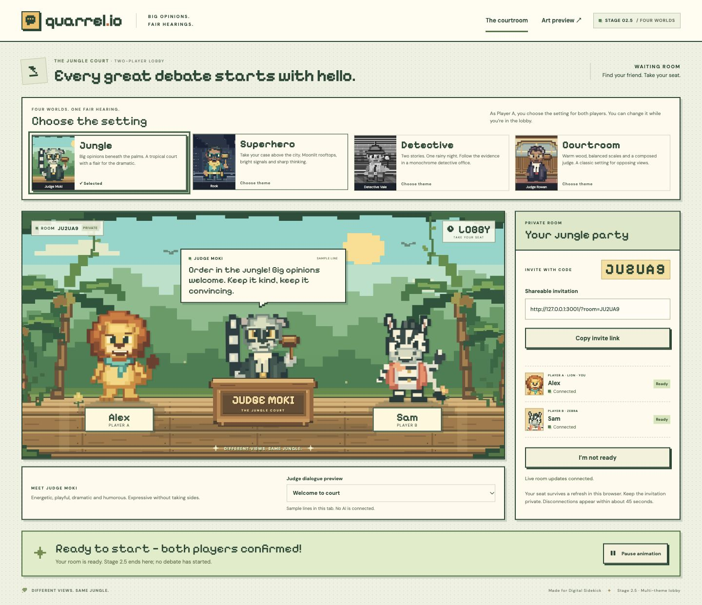
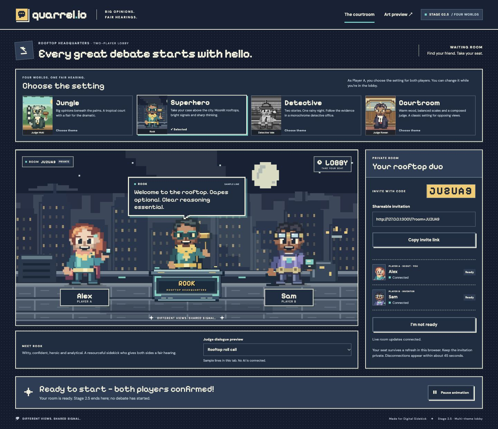
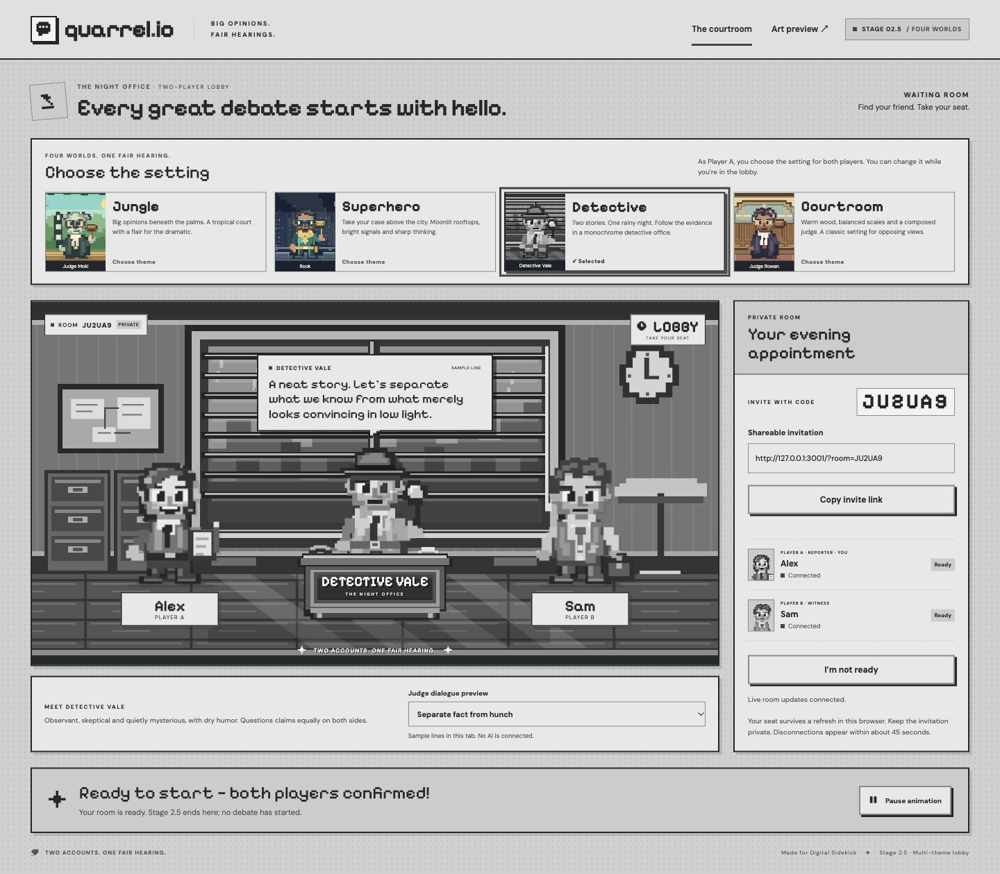
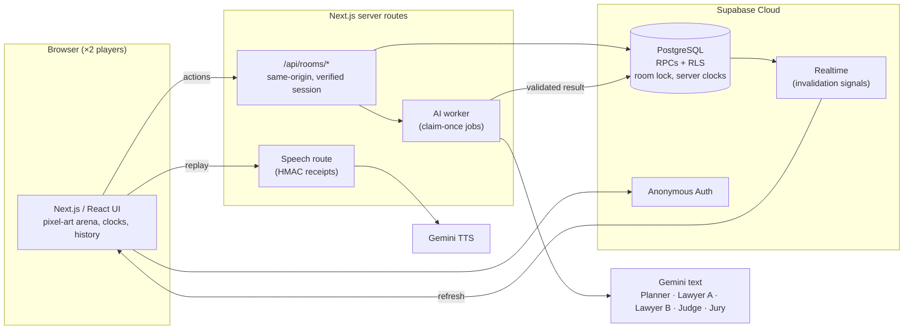

# Quarrel

**Argue it out, with a lawyer in your corner.**

quarrel.io is a real-time, two-player, pixel-art debate game. Each player argues their side of a disagreement through a personal **AI lawyer** (their Digital Sidekick). A neutral **AI judge** summarizes every round, and an **AI jury** delivers the final verdict. The humans stay responsible for their own arguments. The AI helps them organize and present their case without arguing it for them.

🏆 Built in one day for **Fall Hacks 2026**

[**▶ Play it live**](https://falls-hacks-2026-quarrel.vercel.app) · [Technical docs](docs/)



---

## Why we built it

Everyday disagreements, like choosing weekend plans, splitting chores or setting a group project's direction, get frustrating fast. People struggle to organize their thoughts on the spot, talk past each other, repeat the same points and have nobody neutral to keep things on track.

We took inspiration from the playful drop-in rooms of browser `.io` games, AI-assisted dispute analysis tools and character-driven retro pixel-art games. The hackathon's **Digital Sidekick** theme gave us our rule: build an AI that works *alongside* you instead of doing the task for you. quarrel.io doesn't tell two people who is right straight away. It gives each of them a lawyer, gives the room a referee and keeps the argument fair.

## How a debate works

| # | Step | What happens |
|---|------|--------------|
| 1 | **Create a room** | The host creates a private room and shares a six-character code or invite link (`/share?room=CODE`). The guest joins with just a display name. Anonymous sessions mean no sign-up. |
| 2 | **Set the topic** | The host proposes the topic and each player's writing time: **2, 4, 6 or 10 minutes per player**. Each player writes and confirms **only their own** position. |
| 3 | **AI planning** | Once both players confirm their positions and press Ready, the **AI Planner** splits the debate into **2–5 timed subtopics**, each with at least 30 seconds per player. The host can regenerate the plan once, then presses **Start**. |
| 4 | **Argue through your lawyer** | On your turn, write a point (≤600 chars) and choose **Present my argument**. Your lawyer tightens it and restyles it in the theme's persona, without inventing facts or changing your stance, and both players see the result. You can also **Ask my lawyer privately**, and your opponent never sees that consultation. |
| 5 | **Chess clocks** | Each player has their own clock for each subtopic. Only the active writer's clock runs, and **both clocks pause while the AI is working**. Time is enforced by the server, so refreshing the page can't reset it. |
| 6 | **Judge summaries** | When both clocks for a subtopic run out, the **AI Judge** summarizes both sides and highlights the key points of disagreement. |
| 7 | **Jury verdict** | After the last subtopic, the **AI Jury** reviews the public record and returns **Side A, Side B, tie or inconclusive**, with reasons for each subtopic. It judges how well each side argued, not who is objectively right. |

Afterward, each player can **acknowledge** the result (acknowledging doesn't mean agreeing), request a **rematch** (both players must approve) and browse **previous debates**.

### Public presentations vs. private consultations

| | Who sees it | Clock afterward | Limit per player, per subtopic |
|---|---|---|---|
| **Present my argument** | Both players see the lawyer's version. Only the author sees their original draft. | Passes to the opponent if they have time left | 12 presentations · 600-char input · output ≤ 1.5× input (max 900) |
| **Ask my lawyer privately** | Only you. It is never shown to the opponent, the transcript, the judge or the jury. | Your own clock resumes | 2 consultations · 600-char input |

## Four worlds, one set of rules

Every theme has original pixel art, its own judge personality, lawyers, jurors and voices. They all share the same engine, debate rules and neutrality policy. The theme changes the wording and style, never the standards.

| Theme | Setting | Judge |
|---|---|---|
| 🏛️ **Courtroom** *(default)* | Traditional wooden courtroom | Judge Rowan: formal and composed |
| 🌴 **Jungle** | Tropical court with a lion and zebra cast | Judge Moki: playful and dramatic |
| 🦸 **Superhero** | Gothic city rooftop | Rook: witty and analytical |
| 🕵️ **Detective** | Rain-streaked monochrome film-noir office | Detective Vale: observant and skeptical |

| Courtroom | Jungle | Superhero | Detective |
|---|---|---|---|
|  |  |  |  |

The host picks the theme in **Settings** before the debate starts. Players can also set their own local preferences: reduced motion, animation pause, text size and audio.

### 🔊 Talking sidekicks

The lawyers and the judge can read their saved public messages aloud using **Gemini text-to-speech**, with a different voice for each role and a delivery style for each theme. Playback is fully local: you can pause, replay, mute or change the speed without affecting your opponent or the game clocks. If TTS isn't available, the app falls back to browser speech or plain text.

## Architecture



**Five AI roles share one Gemini engine:** Planner, Lawyer A, Lawyer B, Judge and Jury. Each role gets its own instructions, a context window limited to what that role may see, a structured JSON response format and validation on both the server and in PostgreSQL. **Only the jury** is allowed to name an outcome.

### Design principles

- **The database is the authority.** PostgreSQL RPCs serialize every room transition under a lock. They take the player's identity from `auth.uid()` and calculate clocks from server timestamps. The browser can never send a player ID, phase change, deadline or winner.
- **Privacy by construction.** Row Level Security protects private tables, and Realtime sends only "something changed" signals, never message bodies. Each player receives a snapshot filtered for them. Private consultations and original drafts never reach the judge or jury.
- **AI work runs exactly once.** Jobs are reserved before generation, claimed once and saved only after validation, so both players read the same stored result. A late response can't overwrite a completed one.
- **Failures never stall a debate.** If a lawyer rewrite fails, the player's unchanged text is published with an *unedited fallback* label. A failed jury call stays retryable and **never fabricates a verdict**. A demo mode (`JUDGE_AI_MODE=demo`) produces clearly labelled, deterministic responses.
- **Secrets stay on the server.** The text and TTS features use **separate Gemini keys**, so each has its own rate limit. The app has no Supabase service-role key; the browser uses only the publishable key.
- **Untrusted input.** Participant text is treated as data and kept separate from the AI's instructions. Threats, abuse or coercion get a safer redirection instead of being judged as arguments.

## Tech stack

| Layer | Tools |
|---|---|
| Frontend | Next.js 16 (App Router), React 19, TypeScript, Tailwind CSS 4, original SVG pixel art |
| Backend | Next.js server routes, Supabase (PostgreSQL, Realtime, Anonymous Auth, RLS) |
| AI | Google Gemini API: text (5 roles) and TTS (separate key) |
| Testing | Vitest, Testing Library, jsdom, pgTAP database tests, Supabase Cloud integration suites |
| Deployment | Vercel, GitHub Actions CI |

## Run it locally

**Requirements:** Node.js 22.12+, npm and a Supabase project with the migrations in [`supabase/migrations/`](supabase/migrations) applied and anonymous sign-ins enabled.

```sh
git clone https://github.com/diamster/falls-hacks-2026-quarrel.git
cd falls-hacks-2026-quarrel
npm ci
cp .env.example .env.local   # then fill it in, see below
npm run dev                  # http://127.0.0.1:3000
```

`.env.local` (git ignores this file, never commit it):

```ini
SUPABASE_URL=https://<your-project>.supabase.co
SUPABASE_PUBLISHABLE_KEY=<publishable key, never the service-role key>

# Optional. Leave blank to use deterministic demo mode.
GEMINI_API_KEY=
GEMINI_MODEL=gemini-3.1-flash-lite
GEMINI_FALLBACK_MODEL=
JUDGE_AI_MODE=auto            # auto | demo
JUDGE_AI_TIMEOUT_MS=8000

# Optional speech key, separate from the text key
GEMINI_TTS_API_KEY=
GEMINI_TTS_MODEL=gemini-3.8-flash-tts

# Server capability for AI jobs. Generate with: npm run judge:setup
JUDGE_SERVER_SECRET=
```

All Gemini keys and `JUDGE_SERVER_SECRET` are **server-only**, so never give them a `NEXT_PUBLIC_` prefix. For a new Supabase project, `npm run judge:setup` generates the capability and the SQL that registers only its hash. Review that SQL before you apply it.

**Testing both players on one machine:** use two different browsers, or a normal window and a private window. Tabs in the same browser share one player session. Stick to one hostname, because `localhost` and `127.0.0.1` keep separate cookies.

## Testing

```sh
npm run typecheck   # TypeScript
npm run check       # Vitest unit/component tests with coverage gates, then production build
npm run test:db     # pgTAP database tests against local Supabase
```

The most recent recorded full run passed **702 tests** (7 optional tests skipped), with coverage of about 97% of statements and 94% of branches. The coverage gates are 90% and 85%.

The Cloud integration suites (`test:supabase`, `test:api`, `test:leave`, `test:lawyer`, `test:stage6a`, `test:stage6b`) run against the backend in `.env.local`. They create synthetic anonymous users and rooms, and they only run when you opt in:

```sh
QUARREL_ALLOW_REMOTE_TESTS=true QUARREL_TEST_URL=http://127.0.0.1:3000 npm run test:lawyer
```

Point these suites only at a development project you control. See the [testing reports](docs/) for what each stage actually verified and where its limits are.

## Project layout

```
src/
  app/                 Next.js routes: /, /share, /settings, /preview, /api/rooms/*
  components/          Arena, lawyer debate UI, history panel, results, speech, settings
  lib/                 Shared types, room client (Realtime, heartbeat, recovery), speech playback
  server/              Gemini engine, AI worker, lawyer/judge/jury policy, room API, TTS provider
  themes/              Four theme configs, pixel-art assets, voice config
supabase/
  migrations/          Additive schema: rooms → themes → debate engine → judge → lawyers → results
  tests/database/      pgTAP authorization, privacy and clock tests
tests/                 Vitest suites + Cloud integration scripts (tests/db/*.mjs)
docs/                  Stage-by-stage decisions, API contracts and verification reports
```

## Challenges

- **Multiplayer sync.** Keeping two clients on the same subtopic and clock state, pausing both clocks during AI calls and handling disconnects without giving anyone extra time. We solved this on the server rather than in the browser.
- **Faithful sidekicks.** The lawyers restyle and structure what the player wrote, but they must not add facts or change the player's stance. Five roles with separate duties needed strict prompt boundaries and output validation.
- **Privacy between opponents.** Private consultations had to stay hidden from the other player and stay out of the judge's and jury's evidence.
- **Rate limits.** Free-tier Gemini quotas forced us to build retries, a separate TTS key, an optional fallback model and labelled fallbacks, so an exhausted quota never traps players in a half-finished debate.

## What's next

- 🎙️ **Voice input:** speech-to-text so players can speak their arguments or talk to their lawyer
- 🎨 **Character customization:** choose pixel-art avatars within each theme
- 👥 **Team mode:** up to four players per side, taking turns as their team's representative

## Team

Built at Fall Hacks 2026 by **Ryan Fu**, **Alex Lee**, **Kyunghwan Ko** and **Chaitanya Mittal**.

## License

[MIT](LICENSE)
