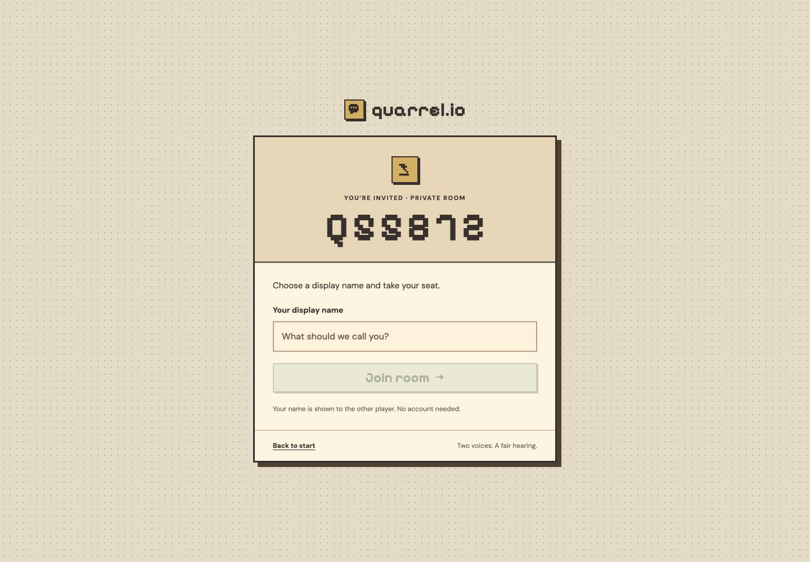
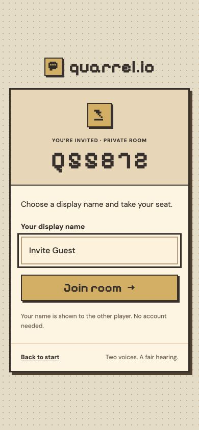

# Dedicated room invitations

Branch: `quarrel-share-invite`, based on `main` at `345af08`.

Shared invitations now use `/share/?room=DU4M9S`. Next.js may normalize the trailing slash to `/share?room=DU4M9S`; both reach the same dedicated page. The room code is the heading, followed by a display-name field and **Join room**. The guest does not need to choose a join tab or enter the room code again.

After the existing join API confirms membership, the page replaces its URL with `/?room=DU4M9S` and opens the existing room interface. A saved seat in the same room offers **Open room** instead of changing the player's name. A saved seat in another room offers Resume or the existing explicit leave confirmation; opening an invitation never automatically abandons a room.

Malformed, missing or repeated codes show an invitation error. Server errors such as full, closed or nonexistent rooms remain visible without discarding the typed name. Pending requests block duplicate clicks. The page reveals no target-room details before joining, and uses the existing anonymous session, two-player limit and server-side authorization.

## Integration boundary

The user approved the narrow overlap with ongoing `stage5-ui` work before implementation:

- Only one application line changes in existing UI: the invite URL generated in `src/components/room-controls.tsx`.
- Four existing test expectations follow that new URL.
- The new route, component, scoped CSS and tests live in separate files.
- No existing lobby/courtroom markup, shared styles, API, database schema, authorization, theme assets or debate mechanics change.
- Manual code joining and old `/?room=CODE` entry remain available.

Keep this branch separate until the UI owner is ready to integrate it. No merge to `main` or production deployment is part of this change. Do not copy production secrets into Vercel Preview to make an automatically generated preview work.

## Verification

- Focused invitation suite: 25 tests passed, including successful and failed joins, duplicate protection, code validation, saved rooms and explicit leave/cancel behavior.
- `npm run check`: 564 tests passed, 5 opt-in tests skipped; TypeScript, coverage gates and production build passed. Coverage: 96.53% statements, 93.49% branches, 95.28% functions and 98.2% lines. An initial run hit two existing UI-test timing limits; the unchanged rerun passed without relaxing assertions or timeouts.
- Supabase Cloud regressions passed: application API checks, 15 database/Realtime checks, 8 debate checks (including actual turn expiry), 7 leave-room checks and 7 judge checks using deterministic demo mode. No live AI calls or schema changes were needed. A development-server leave test was interrupted by a Next.js hot-reload manifest error; the production-server rerun passed.
- Browser verification against the production build: host created a room and received the new URL; a fresh guest entered a name and joined directly as Player B; both sessions displayed the same names and connected status after refresh; reopening the invitation offered **Open room**; a third participant received the full-room error with their name retained; an invalid code showed a clear invitation error. No console errors were observed in the guest or third-participant sessions.
- Desktop (1440 × 1000) and mobile (390 × 844) layouts were inspected with no horizontal overflow. Browser sessions used separate localhost origins in one Chromium engine; Safari was not separately tested.
- Whitespace checks passed. The existing UI change is limited to the approved URL line and matching assertions.

For local testing, run this branch with the existing ignored environment configuration, create a room in one browser session and open its copied invitation in an independent session. Enter a name and join; both sessions should show the same room and the guest's name. Refresh the guest and verify its seat remains. A third session should receive the full-room error.
