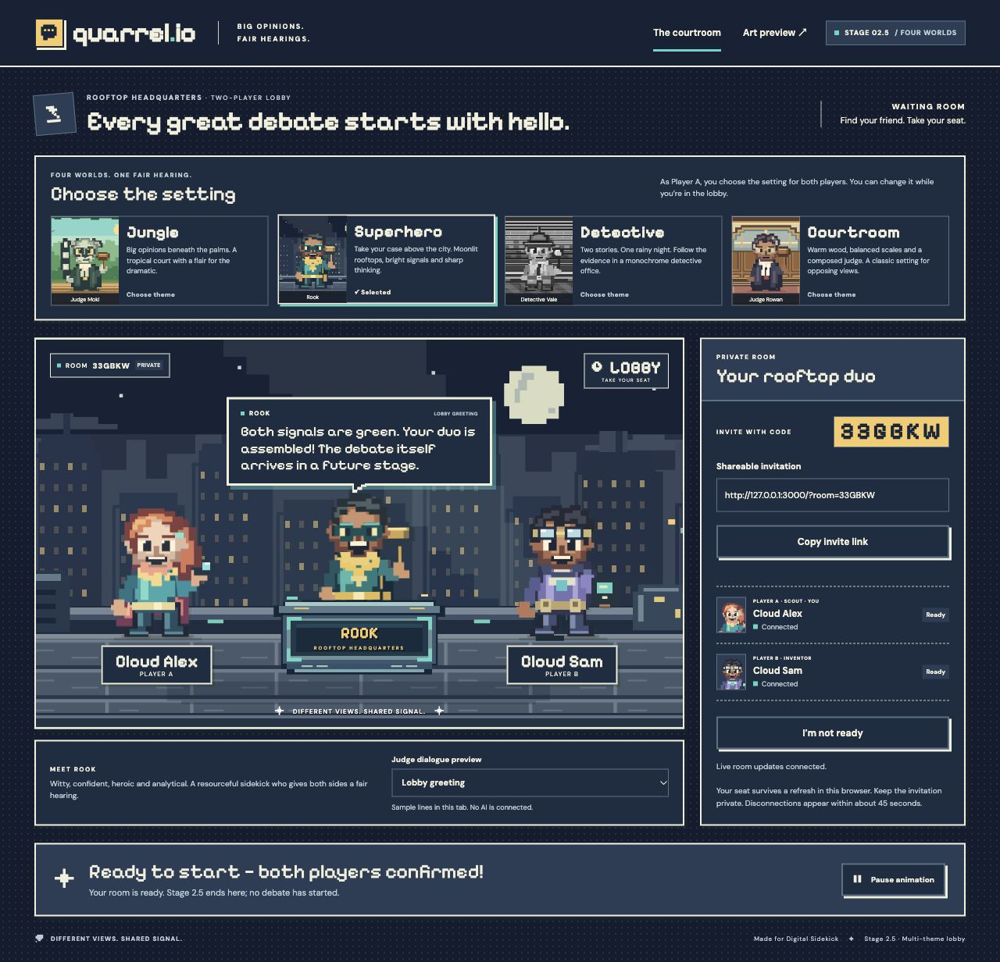

# Stage 2.5 — Supabase Cloud follow-up

November 7, 2026. Target project: `exjdvtqsalnkghyohyuh`, API URL `https://exjdvtqsalnkghyohyuh.supabase.co`. Scope is connecting the existing Stage 2.5 app to this user-authorized Cloud development project, preserving its four themes and private two-player rooms. The website still runs locally. No public website deployment or later stage is included.

Cloud Auth, database access and real Realtime delivery have been verified. This report records Cloud evidence separately from the earlier [local-only test report](stage-2-5-testing.md).

## Configuration

The local application reads these server-side variables from ignored `.env.local` beside `package.json`:

```ini
SUPABASE_URL=https://exjdvtqsalnkghyohyuh.supabase.co
SUPABASE_PUBLISHABLE_KEY=your-project-publishable-key
```

Use only a publishable key from the project's API Keys page. No secret/service-role key belongs in app configuration, test fixtures, source control or documentation. Restart Next.js after changing the file. `supabase:env` generates local settings and is not the Cloud setup command.

Anonymous Sign-ins must be enabled in the Cloud project's Authentication Providers settings. `supabase/config.toml` configures the optional local stack only. Existing Cloud Auth rate limits and other protections remain independent of the local configuration. Anonymous sign-in creates a real Auth user with the `authenticated` database role; membership policies and `auth.uid()` checks continue to restrict room access. See [Supabase's anonymous sign-in documentation](https://supabase.com/docs/guides/auth/auth-anonymous).

Local-stack cookies and room codes cannot identify Cloud rooms. On first refresh, a local session may be rejected and cleared; create a new room in Cloud. No local Auth records or room contents are being migrated.

## Schema and migration history

Initial inspection found the Stage 2 schema already applied to Cloud under migration version `20261107175113`. Its function body hashes matched the repository's `202611070001_stage2_rooms.sql`; member-only RLS and the insert/update-only Realtime publication were verified. The existing Stage 2.5 migration, `202611070002_stage25_themes.sql`, was then applied as hosted version `20261107180112` to add persisted theme selection and its host-only RPC. The Stage 2 schema was not replayed.

Management tools can record application timestamps that differ from repository migration filenames. Before a future CLI push, inspect the hosted and local migration histories and reconcile only entries whose schema/content have been verified equivalent. Do not blindly push all local files, rename historical migrations, or reset the hosted database. Current CLI v3 commands default to local targets; hosted targeting and confirmation are explicit. See the [CLI v3 change notice](https://supabase.com/changelog/supabase-cli-v3).

The Stage 2 migration sets the whole `supabase_realtime` publication to INSERT/UPDATE only. This is deliberate: DELETE events cannot be filtered through the same room-membership RLS checks. Preserve that privacy guard; inspect any unrelated publication members before reusing this migration in another project. The same membership checks, no-direct-write grants and two-seat constraints remain in place.

## Verification record

| Check | Status |
| --- | --- |
| Confirm target and inspect existing schema/history | Completed; existing Stage 2 schema identified and verified |
| Apply missing Stage 2.5 migration | Completed using the existing repository SQL |
| Anonymous Sign-ins enabled and verified | User enabled the setting; Auth settings API confirmed `anonymous_users: true` and test sign-ins succeeded |
| `.env.local` uses Cloud URL and publishable key only; Git ignores it | Passed; exactly the two intended variables, file permissions `0600`, no secret key, ignored by Git |
| Hosted Supabase integration | All 15 checks passed after the subscription registration fix described below |
| Actual local application API against Cloud | Passed: create/join/capacity, both readiness updates, all four themes, cookie recovery/renewal and invalid/forged/cross-origin request rejection |
| Browser create/join, both readiness updates and live themes | Passed using two isolated cookie origins in the in-app browser; screenshot below |
| Browser refresh/restart recovery | Passed in both isolated sessions after restarting Next.js and refreshing both pages; player names, readiness and Superhero selection persisted, live updates reconnected, and neither page reported console warnings/errors |
| Regression tests, coverage and production build | `npm run check` passed: 158/158 tests, 99.60% statements, 95.86% branches, 100% functions/lines, Webpack build and TypeScript passed |
| Local pgTAP regression checks | 84 assertions passed |
| Local Supabase integration with the same subscription fix | All 15 checks passed using the preserved local environment, confirming the CI backend remains supported |

The initial Cloud integration run passed create/join/access checks but missed the first readiness change. Inspection of the installed SDK and its [official source](https://github.com/supabase/supabase-js/blob/master/packages/core/realtime-js/src/RealtimeChannel.ts) identified the cause: by default `SUBSCRIBED` can report the socket join before the database change subscription is active. This also explains the earlier intermittent local first-event failure.

The app and integration channels now request `postgres_changes_options: { wait: true, timeout: 10000 }`. The app marks live status only after that confirmation and refreshes the room snapshot on connection/reconnection to recover changes made during registration. A regression test covers delayed registration, reconnection and callbacks after unmount. Delivery assertions, the 15-second outer subscription deadline, the 10-second event deadline and application heartbeat/disconnect timings were not relaxed. The subsequent Cloud run passed all 15 checks.

Supabase's performance advisor reported no findings. Security advisories flagged the six authenticated `SECURITY DEFINER` RPCs and two anonymous-member read policies. These are deliberate: RPCs authenticate via `auth.uid()`, restrict membership/slot/expiry, use an empty search path and revoke public/unauthenticated execution; table writes are denied. Anonymous users can read only their own room through membership policies. Real outsider/peer mutation tests passed. Reference: [RPC advisory](https://supabase.com/docs/guides/database/database-linter?lint=0029_authenticated_security_definer_function_executable) and [anonymous access advisory](https://supabase.com/docs/guides/database/database-advisors?queryGroups=lint&lint=0012_auth_allow_anonymous_sign_ins).

Browser test: host created a new Cloud room, selected Detective before the guest joined, both names appeared, each player's readiness propagated, and switching to Superhero updated the guest without a refresh. Guest theme controls stayed read-only. Restarting Next.js and refreshing both sessions preserved names, readiness and the selected theme; both live connections recovered without browser warnings/errors. This used `127.0.0.1:3000` and `localhost:3000` as independent cookie origins, not separate browser engines. Native Chrome control permission was unavailable, so Chrome/Safari compatibility is not claimed. The earlier desktop/mobile artwork checks remain recorded in the Stage 2.5 report; this follow-up did not change layout or assets.



## Running the checks again

With the Cloud development settings loaded:

```sh
QUARREL_ALLOW_REMOTE_TESTS=true npm run test:supabase
```

The explicit opt-in allows writes to the selected hosted development project. This suite creates three anonymous accounts, one room and two player rows, then checks concurrent joins/capacity, private reads, peer mutation denials, readiness Realtime, all four theme updates, session recovery and a real 36-second disconnection window. It closes its channels but does not delete those fixtures. Do not use this command on an unrelated or production project.

Start the app with `npm run dev`, then in another terminal run:

```sh
QUARREL_TEST_URL=http://127.0.0.1:3000 npm run test:api
```

The API test uses separate cookie jars and the backend configured in the running app. It creates another three anonymous users and one room; a local website URL does not imply a local database. Repeated runs consume Cloud Auth sign-in quotas. Room expiry is enforced after 24 hours, but rows and anonymous users remain; it is not automatic cleanup. Any later cleanup must target known test fixtures only.

For manual checks, use separate browser profiles/private windows: create a room as A, join as B, toggle each player's Ready button, change all four themes as A, and refresh both sessions. Confirm B cannot change the theme and a third player cannot take a seat. Record whether different browser engines were actually used; separate origins in one browser test session isolation, not engine compatibility.

CI remains isolated: `npm run check`, local Supabase, `npm run test:db`, and local API/Realtime tests. No Cloud credentials are required in GitHub Actions. Keep the original local test evidence and Cloud test evidence distinct.

## Remaining boundaries

- The local website requires this computer to be running. Cloud database connectivity does not create a public app URL.
- This remains Stage 2.5: no debate turns, AI, actual start transition, real objections/verdicts, character picker or team gameplay.
- Hosted production load, public abuse protection, reverse proxies, HTTPS website deployment and cross-device behavior require separate verification before public release.
