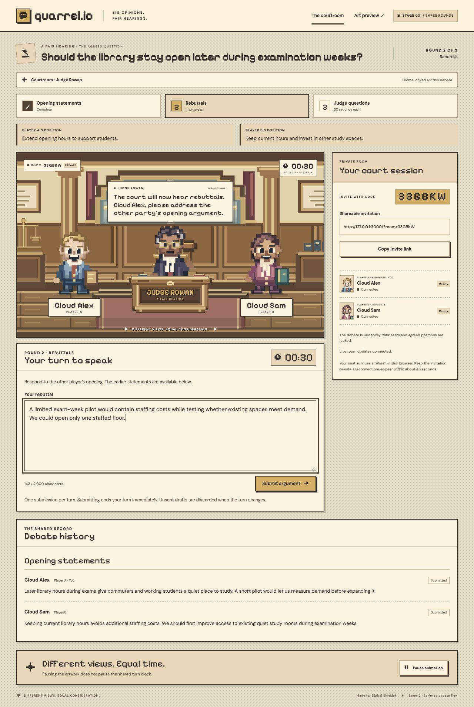
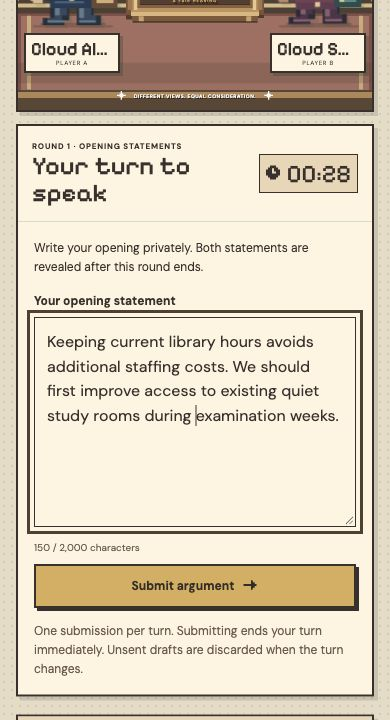
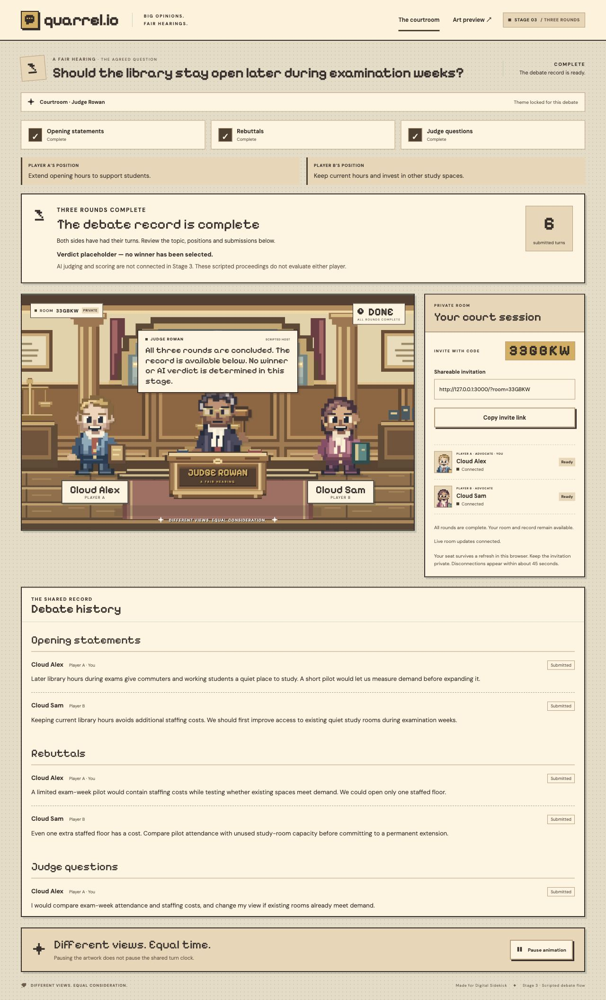

# Stage 3 testing and implementation record

November 7, 2026. Branch: `quarrel-stage-3`. Backend: the existing authorized Supabase Cloud project `exjdvtqsalnkghyohyuh`. The website runs locally at `http://127.0.0.1:3000` (also reachable as `localhost:3000`). The local app and Cloud verification did not use Docker. GitHub Actions separately verified the committed code using its existing isolated test database. No public website was deployed.

## Implemented boundary

The existing two-player rooms, verified anonymous sessions, four original themes, names, readiness, connection indicators and `/preview` remain. Stage 3 adds:

- Host proposal of a topic and two distinct opposing positions; submitting confirms the host’s side. The guest approves or requests changes. Revisions invalidate stale approvals and clear readiness.
- An explicit host start that requires both topic/position approvals, both players ready and both currently connected, then locks topic, positions, readiness and theme.
- Six sequential turns: A/B openings (45 seconds each), A/B rebuttals (45 seconds each), A/B placeholder clarification answers (30 seconds each).
- Private opening storage and simultaneous reveal after both opening turns complete, whether by submission or timeout. A player can recover their own private receipt before reveal.
- One submission per turn, server deadlines, authorized timeout reconciliation, persisted history and refresh recovery.
- Theme-specific scripted announcements, a shared countdown, comfortable text entry and a neutral completion screen. No winner, score, LLM, objections, direct judge chat, customization or team gameplay.

## Database migration review and application

Before changes, Cloud had the existing room/player tables, four rooms and the Stage 2/2.5 migrations. The new migration was independently reviewed for grants, RLS, concealment, lock ordering, duplicate writes and deadline transitions before application. It adds `quarrel_private.debates`, `quarrel_private.debate_entries`, a public room version counter and scoped RPCs. Existing tables/data were preserved; no reset or historical migration replay occurred.

| Repository migration | Cloud recorded version |
| --- | --- |
| `202611070001_stage2_rooms.sql` | `20261107175113` |
| `202611070002_stage25_themes.sql` | `20261107180112` |
| `20261107182430_stage3_debate_engine.sql` | `20261107183149` |

Management-tool application timestamps differ from local filenames. Inspect and reconcile verified history before any future CLI database push. Do not replay the initial schema or reset Cloud to make the histories match.

Private debate tables have RLS enabled, no client table grants/policies and no Realtime publication. The existing public room/player membership policies remain. Public room events contain an invalidation counter, never argument text. Every mutation uses the verified `auth.uid()` and the room row lock. Public inputs contain proposal revisions and turn indexes, not user IDs, deadline overrides or arbitrary phase changes.

## Checks performed

| Check | Result |
| --- | --- |
| `npm run check` | Passed: 235 tests across 8 files, coverage gates, production Webpack build, TypeScript and all routes |
| Coverage | 99.25% statements, 97.02% branches, 99.54% functions, 100% lines; original thresholds unchanged |
| Existing Cloud room/theme suite | All 15 checks passed: create/join/capacity, private access, readiness, all four live themes, recovery and real disconnection |
| Existing HTTP API suite against the Cloud-connected app | Passed: room creation/joining, full/invalid rooms, readiness, themes, identity/cross-origin rejection and actual token renewal |
| New Cloud debate integration suite | All 8 grouped checks passed, including a real 45-second expiry, all six transitions and exact 30-second question deadlines |
| Cloud SQL assertions | All 52 assertions passed with actual authenticated database role/JWT identity changes; synthetic fixtures and administrator-only clock adjustments rolled back |
| Full browser debate | Passed: proposal → change request → revised approval → readiness → explicit start → all six submissions → shared placeholder verdict |
| Browser refresh and history | Host refreshed during rebuttals; guest refreshed during questions and after completion. Both recovered the right turn/theme and six history entries |
| Browser timer synchronization | Both sessions displayed the same 45-second opening countdown at the observed instant; server timestamps/expiry additionally checked by integration tests |
| Responsive layout | Desktop at 1280px and guest at 390px; mobile input and submit usable, document width remained 390px with no horizontal overflow. A temporary 390px iframe also checked composition and was removed |
| Original Stage 1 preview | Dialogue cycling, character state and motion pause still worked; original artwork preserved |
| Browser console | No warnings/errors in the verified host, guest or original preview views |
| pgTAP suite | All 177 assertions across three files passed in GitHub Actions, including the new 93-assertion debate suite. Not run locally or against Cloud, which has no pgTAP extension; Cloud was verified with 52 extension-free assertions and the real service suites above |

[GitHub Actions run 42402729245](https://github.com/diamster/falls-hacks-2026-quarrel/actions/runs/42402729245) passed for implementation commit `775b7a4d3f52e644018835bff377985e6491ddfa`: unit/component tests and coverage, production build, all database assertions, HTTP API tests, the existing room/theme integration suite and the new debate integration suite. This report-only follow-up does not change the tested application or migration.

The new integration suite tests concurrent start and submission requests from the same authenticated player; exactly one succeeds. It checks that stale revisions, guest/outsider setup changes, forged identity fields, future turns, duplicate arguments, empty/overlong text and late text are rejected. A 2,000-codepoint argument containing astral Unicode characters succeeds; 2,001 codepoints fails.

Before reveal, the integration suite searches for the unique opening marker in the opponent’s recovered snapshot, direct `SELECT *` room rows and the actual room-version Realtime event. It also verifies blocked private-schema reads and that outsiders receive neither room rows nor Realtime updates. Browser review independently confirmed the opponent’s opening was absent before their own submission.

The Cloud SQL file exercises a longer simulated offline interval solely on new synthetic test fixtures inside a rolled-back transaction. It verifies original-deadline chaining, no fabricated argument text, no turn reset, and safe authenticated reconnection. This simulation is separate from the integration suite’s real 45-second wait; production durations were not shortened.

## Browser evidence

Two independent cookie origins (`127.0.0.1` and `localhost`) in the in-app browser represented the players. This verifies session isolation, not separate rendering engines. Native Chrome/Safari and physical-device touch/keyboard behavior were not tested.

The browser test reused the earlier synthetic Cloud room with “Cloud Alex” and “Cloud Sam.” It changed the topic after a guest request, approved both positions, and submitted all six arguments. The locked Courtroom theme and judge remained throughout. Automated rendering checks cover all four themes; Cloud regression checks switch all four in the lobby.







## Advisor review

The performance advisor returned no findings. Security notices were reviewed:

- Private tables have RLS without policies intentionally: client table access is denied, and narrow authenticated RPCs provide filtered snapshots. [RLS-without-policy notice](https://supabase.com/docs/guides/database/database-linter?lint=0008_rls_enabled_no_policy).
- Twelve authenticated `SECURITY DEFINER` RPCs are intentional entry points. They check identity/membership, use an empty search path, and restrict host/slot/revision/deadline actions. Private transition helpers are not executable by clients. [RPC notice](https://supabase.com/docs/guides/database/database-linter?lint=0029_authenticated_security_definer_function_executable).
- Anonymous-member read policies remain necessary for account-free rooms; they do not expose a public room directory. [Anonymous access notice](https://supabase.com/docs/guides/database/database-advisors?queryGroups=lint&lint=0012_auth_allow_anonymous_sign_ins).
- Cloud also reported disabled leaked-password protection. This application uses anonymous sessions and has no password registration/sign-in flow; the project-wide setting was not changed. [Password-protection setting](https://supabase.com/docs/guides/auth/password-security#password-strength-and-leaked-password-protection).

No service-role/secret key was used. `.env.local` remains ignored by Git.

## Repeatable checks and practical limits

```sh
npm run check
QUARREL_ALLOW_REMOTE_TESTS=true npm run test:supabase
QUARREL_ALLOW_REMOTE_TESTS=true npm run test:debate
# With the Cloud-connected app running:
QUARREL_TEST_URL=http://127.0.0.1:3000 npm run test:api
```

`tests/db/debate.cloud.sql` can be executed as one transaction through the authorized Cloud SQL connection. It uses built-in assertions and requires no extension installation. Do not strip its transaction or final rollback, and do not replace its random fixture IDs with real room IDs.

The service integration suites each create three anonymous users and one room and retain those fixtures. SQL-only synthetic fixtures roll back. Room expiry is a 24-hour access rule, not physical row/user cleanup. Repeated runs consume Cloud Auth quota; do not weaken rate protections to rerun them. The existing isolated GitHub Actions workflow now also calls `test:debate`; its local CI database does not reconfigure the Cloud-connected app.

The displayed countdown estimates network transit and can differ slightly between clients; PostgreSQL alone accepts submissions. Deadlines keep running through disconnection. If all clients are offline, the next authorized request reconciles elapsed turns using the original deadline chain; there is no always-running scheduler. Unsent drafts are local and do not survive page refresh. Rematches, leaving rooms, public website hosting, real AI questions/evaluation and winner selection remain outside Stage 3.
