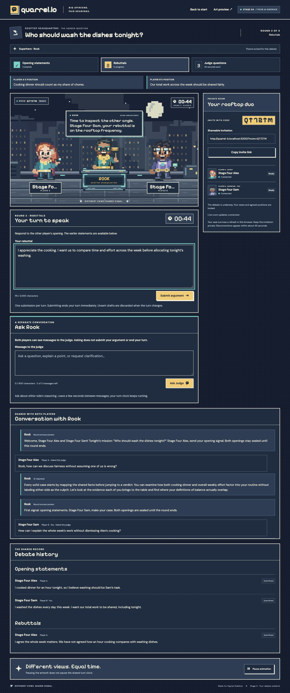
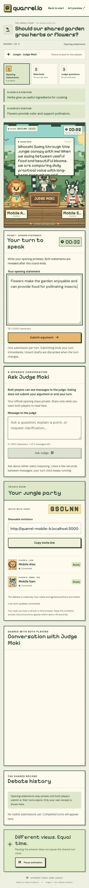
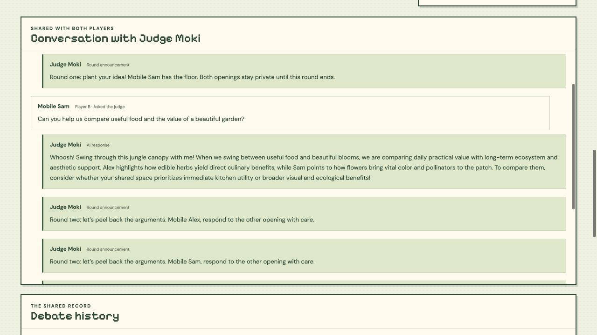

# Stage 4 implementation and testing record

November 7, 2026. Branch: `quarrel-stage-4`. The app runs locally with the existing Supabase Cloud project `exjdvtqsalnkghyohyuh`. Gemini is the AI provider. No local Docker backend or public website deployment was used for this handoff; the GitHub runner uses its separate disposable test database.

## Implemented scope

- One server-only Gemini engine, with the four existing judge personalities and one shared neutrality policy. Original themes, assets, room authorization, readiness, topic approval, six turns, timers, and start/resume behavior remain.
- Separate **Ask Judge** and **Submit argument** controls. Judge chat is shared with both players, requires the current turn, preserves the official draft, and never submits an argument or advances a turn. Default allowance: two messages per turn, 600 Unicode characters each, three seconds between requests, one pending job per room.
- Persisted introductions and round announcements use theme-specific scripted lines. Direct replies and the two clarification questions use Gemini. No AI-generated topics or verdicts.
- Both questions are saved once before Player A's full 30-second answer timer starts. Questions and answers remain associated in the saved history. A pending question job has no active player/deadline.
- Shared thinking/speaking/questioning/listening states, short speech-bubble reactions, accessible conversation history, and mobile layouts. Reduced motion and pause controls remain.
- Explicit AI/demo/fallback labels. With no Gemini key, development uses deterministic responses. API outages, refusal, malformed JSON and timeout use a saved fallback. No automatic paid-call retry.
- Room-only memory: bounded context includes the topic, positions, visible arguments, saved questions and recent shared chat. Concealed openings are excluded in both database and engine code until their simultaneous reveal.

Stage 5 objections, real scoring/winners/verdicts, AI-generated topics, character customization, Team Mode, voice and video remain unimplemented.

## Database review and application

Existing schema/history were inspected first. The new migrations were reviewed for identity checks, worker authorization, private data access, lock ordering, duplicate claims and deadline behavior. Existing tables and rows were preserved. No reset or historical migration replay occurred.

| Repository migration | Cloud recorded version |
| --- | --- |
| `20261107190351_stage4_interactive_judge.sql` | `20261107191236` |
| `20261107191349_stage4_judge_response_validation.sql` | `20261107191524` |

The follow-up checks JSON container types before member validation. Its separate migration preserves the initially applied SQL exactly. Earlier migration mappings are in [the Stage 3 report](stage-3-testing.md). Management-tool timestamps differ from filenames; reconcile verified history before any CLI database push.

`quarrel_private.judge_messages` and `judge_settings` have RLS, no client table grants/policies and no Realtime publication. Existing room events carry a version counter; participants fetch authenticated snapshots. They never broadcast chat text or private opening text in public table events.

Worker RPCs require **both** the verified room member identity and a server-only capability. Only the capability's SHA-256 hash is stored in the private settings row. A participant JWT alone cannot forge a judge response. No Supabase secret/service-role key is used. Runtime credentials remain in ignored `.env.local` and are absent from browser bundles.

Database-generated message IDs, unique per-player request nonces and atomic claims prevent duplicate calls from retries/reconnects. A claimed job is never reclaimed for another model call. A lost worker gets a deterministic fallback after its 20-second lease, on the next authorized request; late completion cannot overwrite it. Existing active-turn deadlines keep running. If clarification generation has not completed, the answer clock starts only when the questions are actually committed.

## Checks performed

| Check | Result |
| --- | --- |
| Unit/component tests, coverage and production build | Passed: 363 tests across 12 files, 3 opt-in live tests skipped, production Webpack build, TypeScript and all routes |
| Coverage | 99.11% statements, 95.52% branches, 98.58% functions, 100% lines; original thresholds unchanged |
| Browser credential scan | Passed across all 41 production static assets; Gemini key and server capability absent |
| Existing Cloud room/theme suite | All 15 checks passed, including create/join, two-seat capacity, privacy, all four themes, readiness, session recovery and genuine disconnection |
| Existing HTTP API suite | Passed against the Cloud-connected local app, including identity/origin rejection and actual session renewal |
| Existing Cloud debate suite | All 8 grouped checks passed, including genuine 45-second expiry, concealed openings and six-turn completion |
| New Cloud SQL assertions | All 114 assertions passed using actual authenticated role/JWT changes; fixtures and administrator-only clock changes were rolled back |
| New HTTP judge integration | All 7 grouped checks passed: three isolated cookie sessions, actual Realtime notifications, direct worker forgery rejection, concurrent duplicate requests, quota, private openings, one saved question pair, exact 30-second deadline, six submissions and recovered shared history |
| Live Gemini smoke tests | All 3 passed in the final run: Player A reply, distinct argument-specific question pair, Player B reply referencing earlier shared chat |
| Browser desktop and mobile | Passed with independent cookie origins. Live replies to both players, pending/thinking state, separate official drafts, relevant questions, refresh recovery and shared records observed |
| Complete manual browser debate | Jungle debate completed with all 6 submitted turns; guest used the 390px layout and refreshed during their question turn |
| Manual timeout recovery | Separate Superhero room completed through genuine expiries when no answer was submitted; no fabricated arguments appeared |
| Browser console | No warnings/errors in the final fresh Jungle sessions. Earlier Superhero sessions had nonfatal Supabase duplicate-client warnings during development hot reload; no critical errors |
| Database pgTAP / GitHub Actions | Final remote result recorded below once the branch run completes |

The Cloud HTTP judge suite made four jobs: sources **AI, AI, fallback, AI**. A separate smoke-test diagnostic confirmed an intermittent Gemini **HTTP 503**. The final three live smoke calls returned HTTP 200 and valid structured responses. Browser testing also observed a clearly labeled fallback, then subsequent successful Gemini replies. Provider availability is not guaranteed; fallback behavior was tested rather than hidden.

Security tests cover malformed responses, extra JSON keys/actions, output tripwires, shared neutrality across themes, untrusted player instructions, private opening exclusion, timeout, provider failure, wrong-turn/outsider requests, forged identity/worker credentials, stale turn/revision, replayed nonces and quota. These establish the tested boundaries, not a proof that every possible model sentence is correct or neutral. The model has no tools or database mutation authority.

## Browser evidence

Separate `*.localhost` origins in the in-app browser provided independent player sessions without replacing the saved user session. This checks isolation, not two different browser engines. Native Chrome/Safari and physical-device touch keyboards were not tested.

The Superhero dishes debate showed live replies for both players. Generated questions referenced the hour spent cooking, the week's dishwashing, and the missing rebuttal when that turn expired. A fresh Jungle garden debate exercised all six submissions: its questions specifically asked for evidence about plant spacing and local pollinator benefits. Refresh during Player B's question restored the same question and remaining server deadline. All four personality configurations/renderings are covered by automated tests and the room/theme regression suite.

At 390px, the document width stayed 390px with no horizontal overflow. The official textarea remained editable while the judge answered. Browser review caught and fixed misleading cross-action loading labels, the narrow completion card, and missing question text in completed history. Screenshots below are actual browser captures. Test tabs were closed and the user's start page was left on the welcome view with the old saved room available to resume.







## Repeatable checks

```sh
npm run check
QUARREL_ALLOW_REMOTE_TESTS=true npm run test:supabase
QUARREL_ALLOW_REMOTE_TESTS=true npm run test:debate
# Keep the Cloud-connected local app running for these HTTP checks:
QUARREL_TEST_URL=http://127.0.0.1:3000 npm run test:api
QUARREL_ALLOW_REMOTE_TESTS=true QUARREL_TEST_URL=http://127.0.0.1:3000 npm run test:judge
# Opt-in paid provider calls; the ordinary test run skips these three tests:
RUN_LIVE_JUDGE_TESTS=true node --env-file=.env.local node_modules/vitest/vitest.mjs run tests/judge-live.test.ts
```

Run `tests/db/judge.cloud.sql` as its complete transaction through the authorized Cloud connection. It requires no extension. Keep its final rollback and synthetic fixture IDs. The 42 new pgTAP checks are for the existing isolated CI database; no pgTAP extension was installed on Cloud.

Remote service/HTTP/browser tests retain synthetic room/auth rows. Room expiry restricts access after 24 hours; it does not physically delete rows or users. The new HTTP judge fixture was `0100c6f8-6258-4606-a01d-93c5bbf3ce75`. Browser fixtures used room codes `QT7ZTM` and `GSCLNN`. Do not rerun against an unrelated project or disable Auth protections to bypass quotas.

## Remaining limits and advisor review

- No always-running worker: pending jobs are processed after authenticated app responses, and offline recovery happens on the next authorized request. A claimed-but-lost job falls back instead of making a second paid call.
- Gemini calls default to an eight-second timeout (configurable within 1–12 seconds). Timing is bounded to fit short turns; an unavailable or slow provider can therefore produce a fallback. Conversation context is bounded to six official entries, two questions and the last eight completed chat pairs.
- Start introductions/transitions are scripted; direct chat and clarification questions are live AI. The model cannot independently verify participant claims or retrieve outside evidence.
- The original authenticated `start_quarrel_debate` RPC is retained for legacy compatibility/tests. An authorized host can deliberately invoke it directly to start a judge-disabled debate; all existing approval/readiness/turn authorization still applies. The application always uses the new capability-protected judged start. Existing saved debates are not silently upgraded.
- Unsent drafts do not survive refresh. Rematches/leaving rooms and physical test-data cleanup remain outside this stage.
- Performance advisor: no findings. Security advisor: private RLS tables without policies (intentional client denial), sixteen authenticated security-definer RPCs (intentional checked entry points), anonymous membership policies (account-free rooms), and the existing project-wide leaked-password-protection notice (no password sign-in flow here). No access was widened to silence notices. See the [RLS notice](https://supabase.com/docs/guides/database/database-linter?lint=0008_rls_enabled_no_policy), [RPC notice](https://supabase.com/docs/guides/database/database-linter?lint=0029_authenticated_security_definer_function_executable), [anonymous access notice](https://supabase.com/docs/guides/database/database-advisors?queryGroups=lint&lint=0012_auth_allow_anonymous_sign_ins), and [password protection setting](https://supabase.com/docs/guides/auth/password-security#password-strength-and-leaked-password-protection).

Gemini implementation follows Google's [generateContent reference](https://ai.google.dev/api/generate-content), [structured response documentation](https://ai.google.dev/gemini-api/docs/structured-output), and [thinking configuration](https://ai.google.dev/gemini-api/docs/thinking). The configured model is an environment setting, not a browser input.
