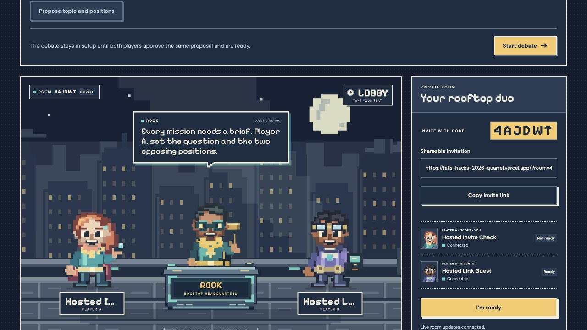

# Vercel deployment

Vercel serves the Next.js website and its authenticated server routes. Supabase Cloud remains the shared database, anonymous-session provider and Realtime service. The browser connects directly to Supabase for room notifications, so this app does not need a custom WebSocket server on Vercel. Gemini calls stay inside the server routes.

## Project settings

- Import `diamster/falls-hacks-2026-quarrel`.
- Deploy the `quarrel-stage-4` branch. Do not accidentally publish an earlier stage from `main`.
- Root directory: repository root (`./`). Framework: Next.js.
- Node.js: `22.x`, matching the tested GitHub runner.
- Install: `npm ci`. Build: `npm run build`. Output directory: framework default.
- Keep a stable production URL for invitations and session recovery. Each hostname has its own browser cookies.

`vercel.json` supplies the framework/install/build settings. Each room route declares a 30-second `maxDuration`, including routes that may process pending judge work with Next.js `after()`. This is a server invocation limit, not a change to the debate's 45/30-second turn timers. The model's own timeout remains separately bounded.

## Server environment

Add these to the Vercel project's Production environment before deploying. Use the values from the existing ignored `.env.local`; do not upload that file, paste secrets into chat, put credentials in source, or use `NEXT_PUBLIC_` prefixes.

| Variable | Setting |
| --- | --- |
| `SUPABASE_URL` | Current Cloud project URL from `.env.local` |
| `SUPABASE_PUBLISHABLE_KEY` | Current publishable key; never the secret/service-role key |
| `JUDGE_SERVER_SECRET` | The **same existing capability** registered in the current Cloud database |
| `GEMINI_API_KEY` | Existing server-only Gemini credential |
| `GEMINI_MODEL` | Existing configured model |
| `JUDGE_AI_MODE` | `auto` for Gemini when configured; `demo` only for an intentional demo deployment |
| `JUDGE_AI_TIMEOUT_MS` | `8000` (current default) |
| `JUDGE_MAX_MESSAGES_PER_TURN` | `2` (current default) |

Do not run `judge:setup` to generate a different capability for Vercel. All instances on this Cloud project must share the registered capability. No database reset, migration replay, anonymous-auth change or new service-role credential is needed for hosting. The existing anonymous sign-in flow has no OAuth callback to add.

Environment changes require a new deployment. Local environment files and Vercel link metadata are excluded from Git and CLI source uploads. Preview deployments should receive credentials only if they intentionally use this same Cloud backend; they otherwise fall back to the project's unconfigured-room screen.

## Invite flow

1. Open the stable public URL in Browser A and create a **new** room.
2. Copy the invitation generated there; it must start with the public HTTPS hostname.
3. Open that exact link in Browser B (or on another device), enter a name and join.
4. Verify both names, readiness and theme changes synchronize, then refresh both browsers.

`localhost` means each person's own computer. Merely replacing the hostname on an old local room link does not move its owner's browser session to the public site. Create a new room on the deployed site for the first public test. Both players should stay on one hostname rather than mixing production and preview URLs.

## Hosted verification before sharing

- Public page loads without requiring the invited player to have a Vercel account.
- Anonymous create/join succeed over HTTPS; session cookies are HttpOnly, SameSite=Strict and Secure.
- Share URL uses the deployed origin. Refresh restores each player's own seat.
- Realtime synchronizes names, readiness, themes and judge messages for two isolated browser sessions.
- Third-player, wrong-origin and wrong-turn requests are rejected.
- Ask Judge completes after the response on Vercel; both players receive the same saved answer.
- A complete debate reaches the existing placeholder verdict; no real verdict or Stage 5 feature is added.
- Leave/create-another-room works on the public hostname.

Keep Supabase's Auth protections enabled. Anonymous creation is server-side, so hosting egress may share an Auth IP rate limit across visitors. If that limit is actually reached, inspect the Auth logs and configure an appropriate protected signup strategy; do not disable safeguards to make a test pass.

## Status

Deployed and verified on **2026-11-07**:

- **URL:** [falls-hacks-2026-quarrel.vercel.app](https://falls-hacks-2026-quarrel.vercel.app)
- **Target / status:** Production / READY
- **Source commit:** `391c5109213848fc4d078f1271cbcb874356b4b4` on `quarrel-stage-4`
- **Framework / runtime:** Next.js / Node 22.x
- **Build duration:** approximately 49 seconds
- **Deployment:** `dpl_EYnaxa8eD2FdwX3iM5gUgomTcqKb`
- **Project / team:** `falls-hacks-2026-quarrel` / `diamsterac-7087`

The eight listed environment settings were copied to Production with explicit user approval. The Gemini credential, server capability and Supabase publishable key use sensitive storage. No secret values are in source or this report. Standard Deployment Protection keeps preview/generated deployment URLs protected while the stable production domain is public.

Vercel's GitHub login connection is not configured, so this release uses an exact 66-file source snapshot of the committed Stage 4 application, uploaded through the Vercel connector. Automatic deployments on push are **not enabled**. Connect GitHub in Vercel later and select `quarrel-stage-4` as the production branch before enabling them. Subsequent documentation-only commits do not change this deployed source snapshot.

## Verification results

The story tested was: open the public invitation → create/join authenticated room seats → synchronize through the existing Supabase Cloud project → complete timed rounds and shared Gemini interactions → return to the start screen.

| Boundary | Result | Evidence |
| --- | --- | --- |
| Public website | Passed | HTTPS page and invite served without a Vercel account; desktop browser displayed the existing artwork. |
| Browser → server | Passed | Created a room, generated its public invitation, switched theme and recovered the same room after reload. |
| Server → Supabase Cloud | Passed | Three isolated cookie sessions tested create/join, full/invalid rooms, authorization, recovery and leave/create. Cookies remained Secure, HttpOnly, SameSite=Strict and scoped to the room API; private responses were not cached. |
| Realtime → clients | Passed | Actual database events delivered all four theme changes and readiness. The browser displayed the second session's name, Connected and Ready without a reload. |
| Server → Gemini → saved history | Passed | Exactly two live generation jobs returned `source: ai`: one direct reply and one pair of distinct contextual clarification questions. The shared reply completed through Vercel's post-response work; retry reused the saved reply. |
| Debate completion | Passed | Six official turns completed; asking the judge did not submit an argument, change the phase or extend the deadline. Both question turns retained the full 30 seconds and both sessions saw the same history and placeholder verdict. |
| Return to start | Passed | Same-browser leave/create and stale-tab protection passed. The browser's synthetic test room was left and the public Create/Join screen restored for handoff. |

The hosted HTTP/Realtime script passed **5 grouped checks**. These used isolated cookie sessions, not two separately automated browser engines. The additional desktop browser inspection had **zero captured console warnings or errors**. No mobile-device or cross-browser-engine run was repeated for this deployment; the existing responsive UI was unchanged. Synthetic fixtures were retained under normal room expiry; no administrative deletion, reset or migration was performed.

[GitHub verification run 42412027518](https://github.com/diamster/falls-hacks-2026-quarrel/actions/runs/42412027518) passed for the deployed commit:

- Application checks: **377 passed, 3 intentionally skipped** live-provider tests; production build and TypeScript passed.
- Database: **255 assertions passed** on an isolated CI database.
- Application API checks passed; **15** Supabase integration, **8** Stage 3, **7** Stage 4 demo-judge and **6** leave/new-room checks passed.

Local verification also passed the production build and TypeScript. The full local suite passed 376 tests but hit one initial-recovery timeout on the busy machine; the same deployed commit passed all 377 applicable tests in clean CI. The local timeout was not used to weaken the test or alter application behavior.

## Post-deploy observability

- **Error scan:** No error/fatal runtime logs for this production deployment in the 20-minute window ending at 20:46 UTC on 2026-11-07, including the hosted tests.
- **Drains:** None configured for this project.
- **Monitoring:** Vercel runtime logs are available; no installed monitoring integrations or persistent log drains were found. An external error tracker or log drain can be configured separately; this deployment did not add a monitoring subscription.

References: [Next.js on Vercel](https://vercel.com/docs/frameworks/full-stack/nextjs), [function duration](https://vercel.com/docs/functions/configuring-functions/duration), [environment variables](https://vercel.com/docs/environment-variables).
